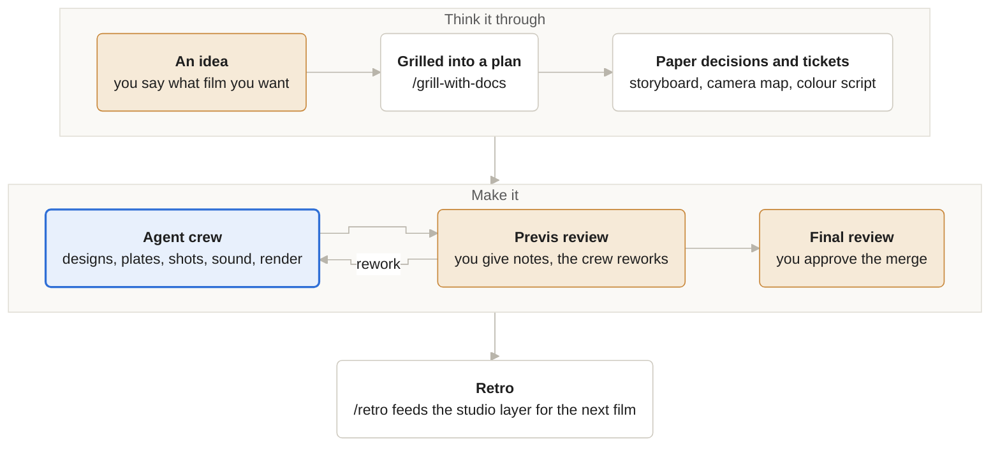

<div align="center">

<a href="https://github.com/JinhaoFang/video-studio/releases/tag/after-rain-v1"></a>

# Video Studio

**One person, a crew of AI agents, and films made entirely from code.**

Our first film, *After the Rain*, is a 65-second animated short. Every frame, the score, the rain, the birdsong and the human voices are computed by the code in this repository.

[Watch *After the Rain*](https://github.com/JinhaoFang/video-studio/releases/tag/after-rain-v1) · [How the crew works](#how-a-one-person-crew-works) · [Make your own](#make-your-own-film) · [中文](README.md)

[](GLOSSARY.md) [](https://www.remotion.dev/) [](https://react.dev/) [](LICENSE)

</div>

## *After the Rain*

> A thunderstorm scatters the flock. A soaked young sparrow huddles on a bamboo pole under the eaves and cannot fly. When the rain stops, it dries its feathers bit by bit in the evening sun, while across the rice field its companions keep calling.


| 65 s · 12 shots | 0 asset files | 36 tickets | Under a day |
|---|---|---|---|
| 1920×1080 at 24 fps, one master for Bilibili and YouTube | No images, recordings or font files, and no models that generate images, music or voices | Planned and accepted by the design lead; 28 of them carried out by engineering agents | About 23 hours from spec to merge, including a night-long network outage |

Download: [1080p (78 MB)](https://github.com/JinhaoFang/video-studio/releases/download/after-rain-v1/after-rain.mp4) · [540p small file (10 MB)](https://github.com/JinhaoFang/video-studio/releases/download/after-rain-v1/after-rain-web.mp4)

**How picture and sound come out of code**

- **Characters**: cel-style line, flat colour and shadow, drawn frame by frame on a Canvas by `src/kit/engine/`. Take-offs, flapping, feather shakes and the walking figure follow written motion rules.
- **Backgrounds**: gouache plates produced by one brush-stroke program, lit per shot. Storm, evening light and dusk differ only in parameters, and a colour script decides how colour tells the time of day.
- **Camera**: a handheld-feeling camera that moves in every frame, with soft focus, bloom, grain and vignette tuned per scene.
- **Sound**: rain is synthesised in layers (distant curtain, roof tiles, ground, drips from the eaves). The sparrow calls, the conversation behind the wall and the humming are all synthesised wordless voices, and the score grows out of the motif from the earlier sample.
- **Title and signature**: the title is written stroke by stroke in running script with the same gouache brush that paints the backgrounds; the four dots of the first character fall like the last four raindrops. The signature is a carved seal.

Each film ends with a work report: [the report for *After the Rain*](docs/reports/spec-168-after-rain.html) (an HTML page; download it and open it in a browser). It lists the time spent, the rework and the known weak spots for every ticket. The report and most project docs are written in Chinese.

## How a one-person crew works

Every film is made by a crew of six departments: writing, art, cinematography, animation, editing and sound. Two agent roles split the work, and the human steps in only when needed.

- **You**: pick the story, review the previs and give notes, approve the final cut.
- **Design lead**: the main session you talk to, acting as director and producer. It writes each department's decisions down (storyboard, camera map, colour script, motion rules, sound design), breaks them into tickets and accepts every ticket.
- **Engineering lead**: the agents the design lead dispatches per ticket, with the framework and model chosen by seat configuration. They write shot code, synthesise sound and render, and hand back results that can be checked objectively.



On *After the Rain*, the previs drew four notes: the walking figure entered too slowly, some shots looked fake, the rain did not sound real enough, and the voices could not be heard. The crew reworked all four before the final cut.

## What is in the repository

```text
episodes/after-rain/   After the Rain: storyboard, camera map, art, motion and sound design, code for 12 shots, sound synthesis, title
src/kit/               shared across films: render engine (line, cel, gouache plates, camera, post, brush writing, seal carving), sound synthesis, sample sheets
src/styles/            style skins, one folder of design tokens each
tools/                 QA and pipeline: frame grabs, comparison, loudness, dropout checks, the pure-code guard
docs/video/            film-making knowledge by department, each entry with sources
docs/roles/            how the design lead and the engineering lead divide the work
docs/workflow/         production workflow: crew, hand-offs, locks, retros
docs/reports/          the work report for each finished film
```

Rules and ownership are in [AGENTS.md](AGENTS.md), terms in [GLOSSARY.md](GLOSSARY.md), and every document is listed in the [docs map](docs/README.md).

## Run it yourself

You need Node.js ≥ 22.18.0, pnpm, ffmpeg and ffprobe. From the repository root:

```bash
pnpm install
node episodes/after-rain/generate.ts
pnpm dev
```

`generate.ts` builds the background plates, the event tables and the final mix for *After the Rain* into `public/episodes/after-rain/` (media stays out of git). `pnpm dev` opens Remotion Studio, where the `AfterRain` composition can be stepped through frame by frame. To render the film:

```bash
pnpm exec remotion render AfterRain out/after-rain/after-rain.mp4 --gl=swangle --concurrency=4
```

`--gl=swangle` renders with software graphics, so no GPU is needed; the 65 seconds take just under half an hour on the author's machine. Covers and release files are covered in the [episode README](episodes/after-rain/README.md#成片与封面复现), and the developer commands in the [developer guide](docs/development.md).

## Make your own film

1. Open Claude Code or Codex in the repository and tell it "you are the design lead". It reads the [role document](docs/roles/design.md) first.
2. Run `/grill-with-docs` and describe the film you want. It questions you point by point until the plan is clear, then `/to-spec` publishes the plan as a spec in GitHub Issues.
3. Run `run-spec` on the spec. The design lead writes the paper decisions, breaks them into tickets, dispatches them to engineering agents and accepts each one; it asks you to review the previs along the way and opens a PR for the final cut.
4. If you are happy, merge, then run `/retro` in a fresh session so what this film taught goes into the studio layer for the next one.

Skill sources and versions are pinned in `skills-lock.json`. The `run-spec` skill comes from [agent-workflow](https://github.com/JinhaoFang/agent-workflow), whose README explains how to install it; the other skills come from [mattpocock/skills](https://github.com/mattpocock/skills) and [remotion-dev/skills](https://github.com/remotion-dev/skills). The full process is in the [production workflow](docs/workflow/README.md).

## Other episodes

| Episode | What it is | Can you watch it |
|---|---|---|
| [Pure-code sample](episodes/pure-code-sample/README.md) | A 13-second, two-shot test made before *After the Rain*, to see whether pure code can reach the look of Japanese theatrical animation | Code and generators are in the repository and can be reproduced |
| [NASA punk opening](episodes/nasa-punk-opening/README.md) | A recreation of an explainer video's opening, the first full run of voice-over, subtitles, shots and mixing | Local study only; its media is not published |
| [ClinMesh promo](episodes/clinmesh-promo/README.md) | A medical product promo made by a collaborator | Asset licences are not fully recorded, so it is not published |

## Licence

- **Code and documentation**: MIT, see [LICENSE](LICENSE).
- **The *After the Rain* film, covers and stills** (the media files in the Release): [CC BY-NC-SA 4.0](https://creativecommons.org/licenses/by-nc-sa/4.0/). Credit "Suyou" with a link to this repository, no commercial use, and share adaptations under the same licence.

*After the Rain* · Suyou · 2026
