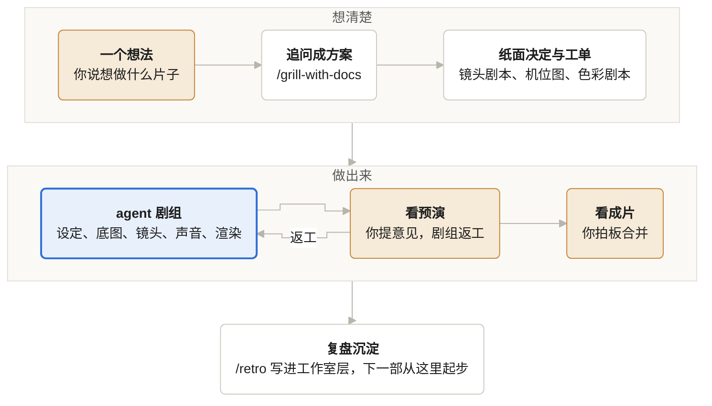

<div align="center">

<a href="https://github.com/JinhaoFang/video-studio/releases/tag/after-rain-v1"></a>

# 视频工作室

**一个人，带一支 agent 剧组，做视频。**

第一部作品《雨后》是 65 秒的动画短片。画面、配乐、雨声、鸟叫和人声，全部由这个仓库里的代码算出来。

[观看《雨后》](https://github.com/JinhaoFang/video-studio/releases/tag/after-rain-v1) · [剧组怎么运转](#一人剧组怎么运转) · [自己做一部](#自己做一部) · [English](README.en.md)

[](GLOSSARY.md) [](https://www.remotion.dev/) [](https://react.dev/) [](LICENSE)

</div>

## 《雨后》

https://github.com/user-attachments/assets/0f2311ec-410b-409a-b2d1-ef6b43460e6a

> 雷雨冲散了同伴，湿透的小麻雀缩在檐下竹竿上，怎么也飞不起来。雨停之后，它在夕光里一点一点晒干羽毛，稻田那头，同伴还在叫它。


| 65 秒 · 12 个镜头 | 0 个素材文件 | 36 张工单 | 不到一天 |
|---|---|---|---|
| 1920×1080，24 帧，B 站和 YouTube 共用一个母版 | 没有图片、录音和字体文件，也没用生成图片、音乐或人声的模型 | 设计负责人拆单、验收，其中 28 张派给工程 agent | 正片从 spec 发出到合并约 23 小时，中间遇上一夜断网 |

上面播放的是 540p 小文件版，看高清请下载：[1080p（78 MB）](https://github.com/JinhaoFang/video-studio/releases/download/after-rain-v1/after-rain.mp4) · [540p 小文件版（10 MB）](https://github.com/JinhaoFang/video-studio/releases/download/after-rain-v1/after-rain-web.mp4)

**画面和声音怎么从代码里出来**

- **角色**：赛璐璐画法，线条、色块和阴影由 `src/kit/engine/` 逐帧画在 Canvas 上；起飞、扑腾、抖羽和人走路都按 [动作规则](episodes/after-rain/motion.md) 来演。
- **背景**：水粉底图，同一套笔触程序按每个镜头的光照生成；雷雨、夕光、暮色只换参数，[色彩剧本](episodes/after-rain/art.md) 管颜色怎么讲时间。
- **摄影**：每帧都在动的手持感相机，加柔焦、光晕、颗粒和暗角，每场一组后期参数。
- **声音**：雨按远处雨幕、瓦顶、地面、檐口滴水分层合成；麻雀叫声、隔墙交谈和哼唱都是合成的无词人声，配乐从小样的动机长出来（[声音设计](episodes/after-rain/sound-design.md)）。
- **片名与署名**：「雨后」用画底图的水粉笔刷按笔顺写成行楷，「雨」的四个点像最后四滴雨落下；署名「溯游」是一方按《说文》字形刻的白文印。

一部片子做完会写一份工作汇报：[《雨后》的汇报](docs/reports/spec-168-after-rain.html)（HTML 页面，下载后用浏览器打开），里面有每张工单的耗时、返工和已知弱点。

## 一人剧组怎么运转

仓库把每部片子当成一个剧组来做：编剧、美术、摄影、动作、剪辑、声音六个部门。两个 agent 角色分工，人只在必要的时候出场。

- **你**：选故事，看预演提意见，看成片拍板。
- **设计负责人**：和你对话的主会话，兼导演和制片。把各部门的决定写在纸面上（镜头剧本、机位图、色彩剧本、动作规则、声音设计），拆成工单，逐张验收。
- **工程负责人**：设计负责人按工单派出去的 agent，用哪个框架和模型按席位配置。写镜头代码、合成声音、渲染，交回能客观验收的产物。



做《雨后》时，用户看完预演提了四条意见：人出场偏慢、有些镜头看着假、雨声不够像、听不出人声。剧组按这四条返工，再出成片。

## 仓库里有什么

```text
episodes/after-rain/   《雨后》：镜头剧本、机位图、美术、动作、声音设计，12 个镜头的代码，声音合成，片名
src/kit/               跨片复用：渲染引擎（线条、赛璐璐、水粉底图、相机、后期、毛笔书写、篆刻印章）、声音合成、样张工具
tools/                 验收与管线：抽帧、对比、响度、断音检查、纯代码护栏
docs/video/            视频知识库：剧组各部门的做法和样片，每条有出处
docs/roles/            设计负责人和工程负责人的分工
docs/workflow/         制作工作流：剧组、交接、锁定点、沉淀
docs/reports/          每部片子做完后的工作汇报
```

规则和目录归属见 [AGENTS.md](AGENTS.md)，术语见 [GLOSSARY.md](GLOSSARY.md)，全部文档的入口是 [文档地图](docs/README.md)。

## 自己跑起来

需要 Node.js ≥ 22.18.0、pnpm、ffmpeg 和 ffprobe。从仓库根目录：

```bash
pnpm install
node episodes/after-rain/generate.ts
pnpm dev
```

`generate.ts` 生成《雨后》的底图、画面事件表和混音，写到 `public/episodes/after-rain/`（媒体不进 git）。`pnpm dev` 打开 Remotion Studio，在 `AfterRain` 合成里可以逐帧看每个镜头。渲染成片：

```bash
pnpm exec remotion render AfterRain out/after-rain/after-rain.mp4 --gl=swangle --concurrency=4
```

`--gl=swangle` 是软件图形，没有 GPU 也能渲；在作者的机器上渲完 65 秒不到半小时。封面和发布文件的做法见 [《雨后》说明](episodes/after-rain/README.md#成片与封面复现)，开发命令见 [开发者手册](docs/development.md)。

## 自己做一部

1. 在仓库里打开 Claude Code 或 Codex，告诉它「你是设计负责人」，它会先读 [角色文档](docs/roles/design.md)。
2. 用 `/grill-with-docs` 说你想做什么。它一条一条追问，直到方案清楚，再用 `/to-spec` 写成 spec 发到 GitHub Issues。
3. 用 `run-spec` 执行 spec：设计负责人写纸面决定、拆工单、派给工程 agent、逐张验收，中途请你看预演，最后开 PR 等你看成片。
4. 满意就合并，再开一个新会话跑 `/retro`，把这部片子学到的写进工作室层，下一部从这里起步。

技能的来源和版本记在 `skills-lock.json`。执行技能 `run-spec` 来自 [agent-workflow](https://github.com/JinhaoFang/agent-workflow)，安装方法见那边的 README；其余技能来自 [mattpocock/skills](https://github.com/mattpocock/skills) 和 [remotion-dev/skills](https://github.com/remotion-dev/skills)。完整流程见 [制作工作流](docs/workflow/README.md)。

## 《雨后》之前

先做过一段 13 秒、两个镜头的 [纯代码小样](episodes/pure-code-sample/README.md)，验证纯代码能不能做出日式剧场动画的质感。引擎、声音合成和样张工具从小样里长出来，后来提进了 `src/kit/`。小样的视频不单独发布，代码和生成器都在仓库里，可以照着复现。

## 许可

- **代码和文档**：MIT，见 [LICENSE](LICENSE)。
- **《雨后》的成片、封面和缩略图**（Release 里的媒体文件）：[CC BY-NC-SA 4.0](https://creativecommons.org/licenses/by-nc-sa/4.0/deed.zh-hans)。转载请署名「溯游」并附上本仓库链接，不用于商业用途，改编后按同样的许可分享。

《雨后》 · 溯游 · 2026
